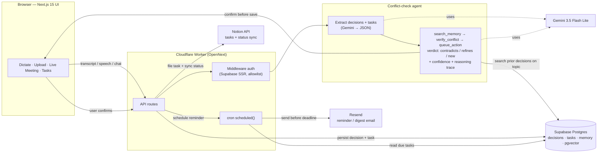

# Told You So — Demo Video Kit

Everything needed to record and edit the ~2.5-minute hackathon demo. Written to be spoken by Akash, solo.

- **Project:** Told You So — the agentic AI that remembers team decisions and objects, with the exact prior quote, when someone contradicts a past decision.
- **Hackathon:** Product Space × Wispr Flow Agentic AI, 2026.
- **Live:** https://told-you-so.told-you-so.workers.dev
- **Built:** entirely hands-free by voice with Wispr Flow (works with Wispr but not dependent — the Live Meeting mode uses Chrome's built-in mic; there is no Wispr API integration).

---

## 1. Video script (~2.5 min)

Read at a calm pace. Target ~330 words. Record in a few short takes and splice (hook+ingest, tasks, live objection, stack+close). Don't narrate what's on screen — say what the viewer can't see.

| Time | On screen | Voiceover (Akash) |
|---|---|---|
| 0:00–0:15 | Black title card: **"Kickoff rule: deadline is tonight, 11:59 PM."** Then it flips to a chat bubble: **"eh, we can just submit tomorrow."** | "Every team re-argues decisions it already made. Someone forgets, someone pushes back, and a settled rule gets quietly reopened — and nobody can find where it was decided. So I built an agent that remembers, and tells you so." |
| 0:15–0:27 | **Told You So** home. Create a **new project**, title card visible, the "60 AI calls / day" pill in view. | "Told You So remembers what your team decided — across calls, Meet, Zoom, WhatsApp, Slack and voice — and it objects, with the exact quote, the moment someone contradicts it. And I built the whole thing hands-free, by voice, with Wispr Flow." |
| 0:27–0:55 | Paste the **hackathon kickoff transcript** (organizer Sakshi briefing the rules) into the input card → **Process** → **"Ingested ✓"** with the rules captured as decisions: submission deadline tonight 11:59 PM IST, team size max 2, demo video 2–3 min with voiceover, no old projects, pick one of five problem statements, deploy with test creds, Wispr Flow mandatory (20% of score), LinkedIn posts by Nov 1. | "I paste in the hackathon kickoff — the organizer, Sakshi, reading out the rules. Gemini pulls them into structured JSON as decisions, each keeping the exact quote, the speaker and the time: deadline is tonight at 11:59, team of at most two, a two-to-three-minute demo with voiceover, Wispr Flow is mandatory, and LinkedIn posts by the first. That's now the team's memory. Nothing's saved until I confirm." |
| 0:55–1:40 | **Live Meeting** mode. A second person pushes back on the rules, and **red OBJECTION cards** pop with the receipt — Then/Now quotes: **"we can just submit tomorrow"** 🔴 vs "deadline is tonight, 11:59 PM"; **"let's add a third person"** 🔴 vs "team size is maximum 2 people"; **"make the demo video like five minutes"** 🔴 vs "2 to 3 minutes". A fourth line, **"let's submit by 11 PM to be safe,"** is **not** flagged 🟡. Click **Keep old** on a card to keep the rule. | "Now the money shot. Live in a meeting, a teammate starts bending the rules. 'We can just submit tomorrow' — objection: the deadline is tonight, 11:59, here's the quote. 'Let's add a third person' — objection: team size is max two. 'Make the demo like five minutes' — objection: it's two to three minutes. Three red cards, instantly, each with the original rule as the receipt. But when he says 'let's submit by 11 to be safe' — it does not flag that. Earlier than the deadline is a refinement, not a contradiction. The agent knows the difference. I click Keep old, and the rule stands." |
| 1:48–2:12 | Quick architecture / stack card (or the diagram from §3). | "Under the hood: Next.js on Cloudflare Workers, Supabase Postgres, Gemini 3.5 Flash Lite. Every new statement runs through a bounded tool-use agent — it searches memory on the same topic, verifies whether it's a contradiction or a refinement with a confidence score and a full reasoning trace, then queues the action. I picked Flash Lite because it's fast and cheap enough to check a live call every few seconds and it does structured tool calls." |
| 2:12–2:30 | End card: live URL **told-you-so.told-you-so.workers.dev**. | "It confirms before it saves, files tasks to Notion, and emails reminders before deadlines. It's live at told-you-so dot workers dot dev — and I built every line of it by voice. Talking is how we think, so that's how it should remember. Thank you." |

**If you run long:** cut the reminders clause in the close first, then trim the kickoff rules you read aloud to the three that get contradicted (deadline, team size, demo length).

---

## 2. Slide / overlay cards (6–7 title cards)

Exact short text for each card. Keep them high-contrast and on screen 2–4 seconds. Suggested palette: dark background, white headline, one accent (stamp red `#D7263D`) for the objection beat.

**(a) Title**
> # Told You So
> The agent that remembers what your team decided — and objects with the receipt.
> _Product Space × Wispr Flow Agentic AI · 2026_

**(b) The problem**
> ## Teams re-argue settled decisions
> Decision logs fail because writing them is a chore.
> So the call gets quietly reopened — and no one can find where it was decided.

**(c) The solution**
> ## It remembers, and tells you so
> Across calls, Meet, Zoom, WhatsApp, Slack and voice.
> When someone contradicts a past decision, it objects — with the exact prior quote.

**(d) How it works — the 2-step agent**
> ## Two steps, not one prompt
> **1. Extract** — decisions + tasks from messy speech → strict JSON.
> **2. Verify** — a bounded agent: search_memory → verify_conflict → queue_action.
> Verdict: contradicts / refines / new · + confidence · + reasoning trace. Refinements are not flagged.

**(e) Architecture**
> ## One Worker, four services
> Browser (Next.js) → Cloudflare Worker (auth · API · cron)
> → Gemini · Supabase Postgres · Notion · Resend.

**(f) Tech stack**
> ## Stack
> Next.js 15 (App Router, TS, Tailwind v4) · Cloudflare Workers (OpenNext + wrangler)
> Supabase Postgres (pgvector) + Supabase Auth · Gemini 3.5 Flash Lite
> Notion API · Resend · cron via Worker `scheduled()`

**(g) Close / CTA**
> # Try it live
> **told-you-so.told-you-so.workers.dev**
> Built entirely hands-free, by voice, with Wispr Flow.

---

## 3. Architecture diagram (Mermaid)

**Data flow in one line:** input → extract (Gemini → JSON) → agent conflict-check vs memory → confirm → persist to Postgres + file to Notion + schedule a reminder.

---

## 4. Title card, end card & lower-thirds

### Title card (2 s, open on it)
> **Told You So**
> _the agent that argues back_
> Product Space × Wispr Flow Agentic AI · 2026

### End card (3 s)
> **told-you-so.told-you-so.workers.dev**
> Built hands-free, by voice, with Wispr Flow.

### Lower-third captions (overlay at the matching beat)

| Beat | Lower-third text |
|---|---|
| Hook | Every team re-argues decisions it already made. |
| Ingest | Gemini extracts the kickoff rules as decisions → strict JSON |
| "Ingested ✓" | Rules captured · exact quote + speaker + time kept |
| Objection #1 | OBJECTION: "deadline is tonight, 11:59 PM" (the receipt) |
| Objection #2 | OBJECTION: "team size is maximum 2 people" (the receipt) |
| Objection #3 | OBJECTION: "demo video is 2 to 3 minutes" (the receipt) |
| Not flagged | "Submit by 11 PM" — refinement, not a contradiction. Not flagged. |
| Stack beat | Next.js · Cloudflare Workers · Gemini 3.5 Flash Lite · Supabase · Notion · Resend |
| Close | Confirms before it saves · live now |

---

## 5. Recording notes

- Chrome full screen, 1920×1080, zoom ~110–125% so text is readable, Focus mode on, bookmarks bar hidden.
- Capture screen + mic (camera off). Record in short takes and splice; redo only a broken take.
- The second voice in the Live Meeting beat is a scripted clip / demo participant — say once that you built this solo, so it reads as honest.
- Keep final length 2:00–3:00.
